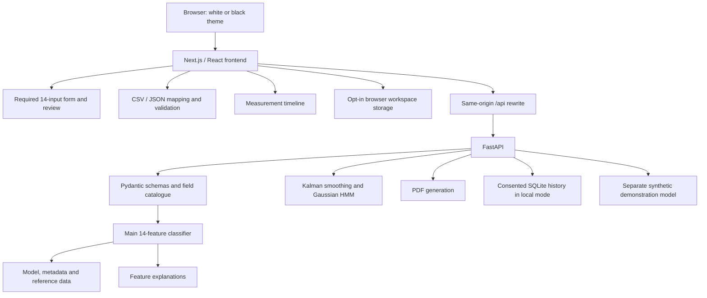
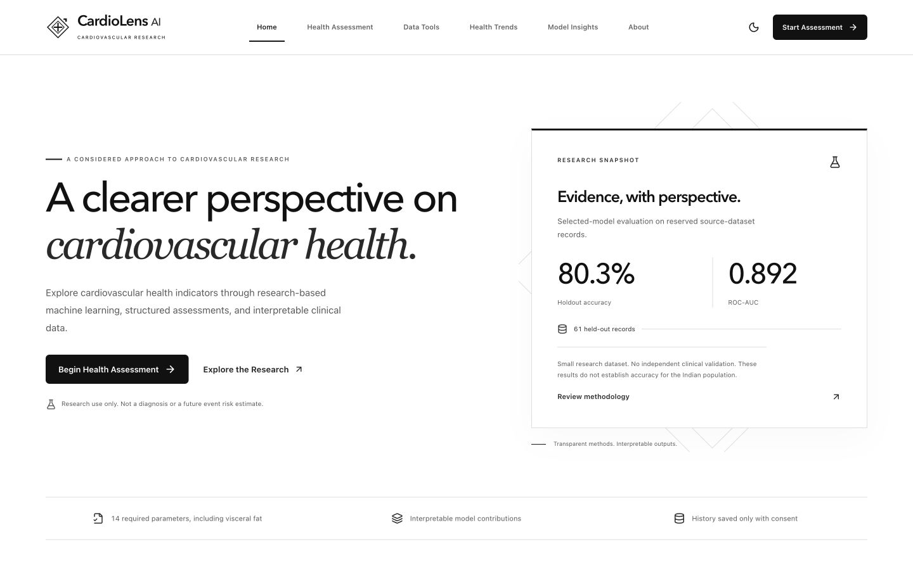
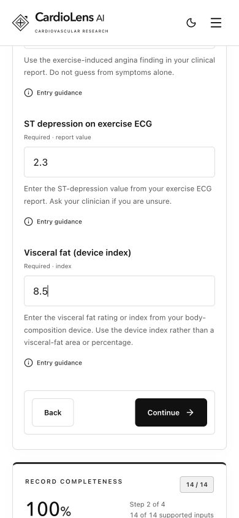
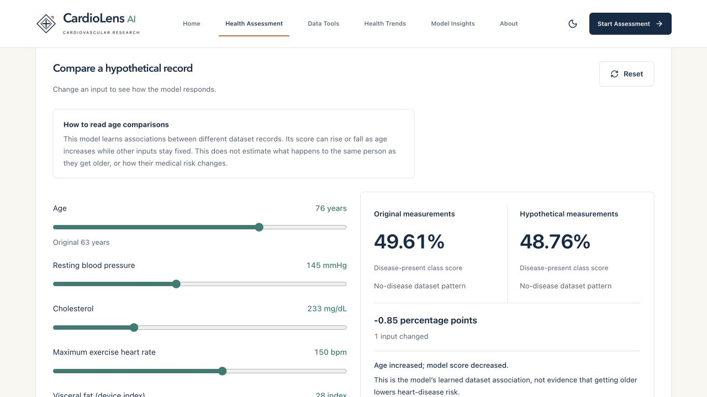

# CardioLens AI — Complete Implementation, Verification and Deployment Report

**Report date:** 18 November 2026, India Standard Time  
**Project:** CardioLens AI  
**Workspace:** `/Users/sayanbasu/Downloads/HeartDiseasePrediction`  
**Published website:** [cardiolens-ai.vercel.app](https://cardiolens-ai.vercel.app)  
**Published calculation service:** [cardiolens-api.vercel.app](https://cardiolens-api.vercel.app/api/health)  
**Current main-model version:** `2.0-bb5ec8e04e`

This report consolidates the work recorded in the project, the changes implemented during our work together, and the results of the latest completed verification and deployment. It describes the application as verified on the report date. It is an implementation record, not a claim that the model has been clinically validated.

**19 November naming/data update:** application and documentation wording now uses neutral source-dataset/UCI Heart Disease labels. A separate [100-person Annapurma Hospital Tamil Nadu synthetic dataset](outputs/annapurma-tamil-100-20261119/DATASET_README.md) has been created. It does not replace the model or turn generated values into measured hospital records. Original source filenames remain in the technical audit for reproducibility.

Historical notes in `docs/VERIFICATION.md` preserve earlier stages. Where those notes mention 13 inputs, optional visceral fat, older test counts, an older colour palette, or earlier hosting limitations, the current state described here takes precedence.

## Contents

1. [Current outcome](#1-current-outcome)
2. [Work completed by phase](#2-work-completed-by-phase)
3. [Application architecture](#3-application-architecture)
4. [Backend bug fixes and code quality](#4-backend-bug-fixes-and-code-quality)
5. [The 14 required assessment parameters](#5-the-14-required-assessment-parameters)
6. [Datasets and provenance](#6-datasets-and-provenance)
7. [Main-model training and evaluation](#7-main-model-training-and-evaluation)
8. [Separate synthetic demonstration](#8-separate-synthetic-demonstration)
9. [How visceral fat enters the calculations](#9-how-visceral-fat-enters-the-calculations)
10. [Prediction semantics and explanations](#10-prediction-semantics-and-explanations)
11. [Age-slider investigation](#11-age-slider-investigation)
12. [Temporal analysis and measurement history](#12-temporal-analysis-and-measurement-history)
13. [Frontend modularisation](#13-frontend-modularisation)
14. [Workspace persistence and draft saving](#14-workspace-persistence-and-draft-saving)
15. [UI, themes and responsive improvements](#15-ui-themes-and-responsive-improvements)
16. [Uploads and batch assessment](#16-uploads-and-batch-assessment)
17. [Reports and export consistency](#17-reports-and-export-consistency)
18. [Page-by-page functionality](#18-page-by-page-functionality)
19. [API contracts](#19-api-contracts)
20. [Verification results](#20-verification-results)
21. [Production deployment](#21-production-deployment)
22. [Running, testing and reproducing the project](#22-running-testing-and-reproducing-the-project)
23. [Important files and artifacts](#23-important-files-and-artifacts)
24. [Remaining limitations and future work](#24-remaining-limitations-and-future-work)
25. [Screenshots and supporting records](#25-screenshots-and-supporting-records)

## 1. Current outcome

CardioLens AI is a web application with a Next.js/React interface and a FastAPI machine-learning service. It supports complete-record classification, feature explanations, hypothetical input comparisons, CSV/JSON assessment, timestamped measurement analysis, and PDF/CSV exports.

The main classifier now uses **14 required inputs, including visceral fat**. Visceral fat is part of the trained feature matrix and prediction pipeline. It is no longer an optional reference value outside the main calculation.

The completed state includes:

- Required visceral fat in the assessment form, request validation, batch assessment and report generation.
- A retrained main model and matching metadata, metrics, distributions and holdout predictions.
- Four-step clinical entry, record review and explanations for all 14 inputs.
- A clearer hypothetical explorer that distinguishes model associations from the effects of aging.
- Optional browser persistence for completed assessments, drafts, upload previews and temporary readings.
- Separate page components instead of a single large workspace implementation.
- Consistent white/light and black/dark presentation.
- Mobile, tablet and desktop layout improvements.
- Correct completeness counts for older saved records.
- Dashboard support for temporary workspace measurements.
- Sample timeline exploration that preserves existing workspace readings.
- Local-calendar date filtering, including daylight-saving boundaries.
- Published frontend and backend services, followed by live verification.

The latest completed checks passed: **80 backend tests, 9 frontend regression tests, TypeScript checking, the production build, and 14 live API checks**.

### Performance and provenance that must remain clear

The current main model achieved **80.33% accuracy on 61 held-out UCI Heart Disease records**. It did not achieve the requested greater-than-85% accuracy on that main holdout.

The visceral-fat values added to the UCI Heart Disease records were **generated**, not measured. Their origin remains recorded in the dataset and model metadata. A separate synthetic demonstration achieved 94.25% accuracy against its artificial labels; that result must not be presented as the accuracy of the main UCI Heart Disease model or as clinical accuracy.

## 2. Work completed by phase

| Phase                  | Work                                                                                                     | Result                                                            |
| ---------------------- | -------------------------------------------------------------------------------------------------------- | ----------------------------------------------------------------- |
| Backend maintenance    | Removed request-time alias mutation, fixed explicit missing-value checks, updated the test client setup  | More predictable parsing, validation and dependency compatibility |
| Temporal robustness    | Relaxed the HMM gap tolerance while retaining numerical and fitting checks                               | Moderately irregular series can be evaluated                      |
| Architecture           | Split workspace sections and reusable components                                                         | Smaller, more focused frontend files                              |
| Persistence            | Added opt-in browser saving and assessment drafts                                                        | Work can survive navigation and, when enabled, refresh            |
| Dataset review         | Examined the combined research and real visceral-fat cohorts                                             | Kept different outcomes and source populations distinguishable    |
| Demonstration model    | Generated a separate simulation dataset and model                                                        | Reproducible demonstration of a predefined visceral-fat effect    |
| Main-model integration | Added the seeded visceral-fat column to the UCI Heart Disease experiment and retrained all candidates            | Main inference genuinely consumes 14 features                     |
| Contract update        | Made visceral fat required throughout complete-record assessment                                         | Missing visceral fat causes rejection rather than silent omission |
| Branding and UI        | Used CardioLens AI branding, removed the top prototype strip, corrected text contrast and unified themes | Cleaner, more consistent presentation                             |
| Scenario investigation | Reproduced the age-related score decrease and checked class orientation                                  | Confirmed learned model behaviour and improved its interpretation |
| Full workflow review   | Exercised forms, uploads, persistence, reports, timeline, charts and navigation                          | Found and corrected additional integration and responsive issues  |
| Deployment             | Published both services and verified public behaviour                                                    | Current implementation is live on the CardioLens domain           |

## 3. Application architecture



### Frontend

The main interface uses Next.js App Router, React, TypeScript, React Hook Form, Zod, React Dropzone, Recharts and Lucide icons. The reusable button follows Radix/CVA conventions. CSS supplies shared layout and theme tokens.

The Next.js dependency was pinned to **16.4.5**, with the lockfile updated. The development and production commands explicitly select Webpack.

### Backend

FastAPI exposes prediction, metadata, upload, history, temporal analysis and report endpoints. Pydantic validates inputs. Scikit-learn implements the static classifiers and preprocessing. SQLAlchemy/SQLite supports consented local history. The temporal implementation combines Gaussian HMM fitting with explicit log-domain inference routines and elapsed-time-aware Kalman smoothing.

### Communication

Frontend requests use same-origin `/api/...` paths. `frontend/next.config.ts` rewrites them to the configured `BACKEND_URL`. The browser does not need a separate hardcoded backend address.

### Local and hosted data handling

Local operation can save measurement history to SQLite with consent. The hosted entry point disables shared server history; it can analyse readings submitted for a session. Optional browser saving is separate from server history and stores data in the current browser profile.

## 4. Backend bug fixes and code quality

### 4.1 Upload aliases no longer change during parsing

In `backend/services/uploads.py`, the alias dictionary is built at module scope, including aliases derived from the canonical field labels. `parse()` reads it without adding entries during a request.

This removes unnecessary shared-state mutation between requests. Aliases include readable clinical headings and common visceral-fat spellings, including `viseral fat`.

The parser continues to enforce file, row, column and cell limits. It does not infer absent measurements or execute uploaded contents.

### 4.2 Blood-pressure validation uses explicit presence checks

The `Measurement` validator in `backend/schemas/clinical.py` checks:

```python
self.systolic is not None and self.diastolic is not None
```

before comparing the pressures. Presence is therefore determined by whether a reading was supplied, rather than its truthiness. Separate numeric bounds still apply.

Timestamp timezone validation and the requirement for at least one actual measurement remain in place.

### 4.3 Test-client deprecation was resolved

`backend/tests/conftest.py` no longer depends on the deprecated Starlette TestClient/httpx adapter path. It provides a synchronous test client over `httpx.ASGITransport`, using an AnyIO blocking portal and the application's lifespan context.

The test database uses an in-memory SQLite connection shared through SQLAlchemy `StaticPool`, and history is cleared around tests. The final backend suite passed with `StarletteDeprecationWarning` treated as an error.

### 4.4 Model and dataset compatibility are checked

Inference checks the saved scikit-learn version, the audited original-field checksum, the complete enriched dataset checksum, and the agreement between model, metadata and the current 14-feature schema.

A missing or incompatible artifact is reported as unavailable. It is not replaced with a hardcoded prediction or a silently retrained model.

### 4.5 Validation is more consistent across the frontend

`frontend/lib/measurement-validation.ts` supplies shared checks for supported numeric measurements and completeness counts. The form, upload preview and saved-record displays use this common interpretation.

This addresses cases such as fractional ages being shown as valid in a preview even though the backend requires an integer age, and an older 13-input record being labelled complete under the current 14-input contract.

## 5. The 14 required assessment parameters

All of the following are required for the main complete-record assessment. Labels are readable in the interface; stable keys are used internally.

| No. | Key            | Meaning                                        | Accepted complete-record input                               |
| --: | -------------- | ---------------------------------------------- | ------------------------------------------------------------ |
|   1 | `age`          | Age at examination                             | Integer, 18–100 years                                        |
|   2 | `sex`          | Sex represented in the source model            | Supported male/female category                               |
|   3 | `cp`           | Chest-pain finding                             | One of four supported source categories                      |
|   4 | `trestbps`     | Resting systolic blood pressure                | 70–250 mmHg                                                  |
|   5 | `chol`         | Serum cholesterol                              | 80–650 mg/dL                                                 |
|   6 | `fbs`          | Whether fasting blood sugar exceeded 120 mg/dL | Recorded yes/no indicator                                    |
|   7 | `restecg`      | Resting ECG finding                            | One of three supported categories                            |
|   8 | `thalach`      | Maximum exercise heart rate                    | 40–230 bpm                                                   |
|   9 | `exang`        | Exercise-induced angina finding                | Recorded yes/no indicator                                    |
|  10 | `oldpeak`      | ST depression on exercise ECG                  | 0–10 report units                                            |
|  11 | `slope`        | Exercise ST-segment slope                      | Supported upward, flat or downward finding                   |
|  12 | `ca`           | Major vessels visible on imaging               | Recorded category 0–3                                        |
|  13 | `thal`         | Stress-test blood-flow finding                 | Supported normal, fixed-defect or reversible-defect category |
|  14 | `visceral_fat` | Visceral-fat device rating/index               | Required finite number, zero or greater                      |

These bounds are software input bounds, not definitions of healthy values.

### Verified category meanings

The supplied file uses some nonstandard recodings. The application preserves the verified local meanings rather than assuming an arbitrary online encoding table.

| Key       | Supported internal values and labels                                                |
| --------- | ----------------------------------------------------------------------------------- |
| `sex`     | `1`: Male; `0`: Female                                                              |
| `cp`      | `3`: Typical angina; `1`: Atypical angina; `2`: Non-anginal pain; `0`: Asymptomatic |
| `fbs`     | `0`: 120 mg/dL or below; `1`: Above 120 mg/dL                                       |
| `restecg` | `1`: Normal ECG; `2`: ST–T wave changes; `0`: Possible enlargement/LVH              |
| `exang`   | `0`: No; `1`: Yes                                                                   |
| `slope`   | `2`: Upward; `1`: Flat; `0`: Downward                                               |
| `ca`      | `0`, `1`, `2`, `3`: Recorded vessel count/category                                  |
| `thal`    | `2`: Normal; `1`: Fixed defect; `3`: Reversible defect                              |

Historical `ca=4` and `thal=0` entries are source missing-value markers. New assessments reject them rather than treating them as recorded diagnostic findings. Unsupported or unknown form choices cannot be used to produce an assessment.

### One field catalogue

The canonical catalogue is `backend/schemas/fields.json`, version `cardiolens-14-inputs-v2`. The frontend copy is `frontend/lib/fields.generated.json`. Tests verify agreement between the copies.

The catalogue supplies labels, units, supported categories, form groups, help and validation messages. The upload template also contains 14 unique readable headings, including visceral fat.

### Assessment records versus timestamped readings

A complete classification requires all 14 inputs. A timeline reading represents measurements actually available at one timestamp and can be sparse. For example, a visceral-fat reading can be tracked without inventing an ECG finding for that date. Sparse readings do not become eligible for the main classifier merely by being placed on the timeline.

## 6. Datasets and provenance

### 6.1 Main UCI Heart Disease experiment

The working main dataset is `backend/data/heart.csv`.

| Property                                  | Current value                                           |
| ----------------------------------------- | ------------------------------------------------------- |
| Raw records                               | 303                                                     |
| Exact duplicates removed before splitting | 1                                                       |
| Unique modelling records                  | 302                                                     |
| Raw `target=1` count                      | 165                                                     |
| Raw `target=0` count                      | 138                                                     |
| Model inputs                              | Original 13 source features plus generated visceral fat |
| Outcome                                   | Verified UCI Heart Disease source disease-status label          |
| Development records                       | 241                                                     |
| Holdout records                           | 61                                                      |

The raw class counts above describe the 303-row file, before deduplication.

### 6.2 Added visceral-fat indices

`backend/ml/add_visceral_fat.py` creates a reproducible device-index example column using seed **20261117**. Generated indices are integers from 1 to 31. Duplicate original records receive the same generated index, so adding the column does not turn an exact duplicate into a different modelling record.

The file records:

- `visceral_fat`: the generated index.
- `visceral_fat_source`: `generated`.

`visceral_fat_source` is provenance metadata, not an additional prediction feature. The target is an outcome, not a fifteenth assessment input.

Original measurements and outcomes remain intact. The model metadata records both the original observed-field checksum and the complete enriched-file checksum:

```text
Observed fields SHA-256:
7c3014365675306819510a49ff289efbec1d1a6a666a2dc7652f1547b383d859

Enriched training file SHA-256:
26e441adc88c81ed9e7bc0bd5b0e238b6dea22051c60d7c1eb0d162fac0e809f
```

Using a generated feature in an actual trained model does not make it a measured clinical feature. Its score contribution can reflect random sample associations.

### 6.3 Supplied combined research and real visceral-fat files

The reviewed supplied files were:

- `CardioLens_Research_1239_Provenance_Preserved.csv`.
- `CardioLens_Visceral_Fat_319_Real_Records.csv`.

The recorded audit found 920 UCI heart-disease outcomes in the combined data, but no rows that jointly contained that UCI outcome and a visceral-fat device index. The 319 Ankara rows matched the standalone visceral-fat cohort after the necessary source-code recoding. That cohort contained 12 recorded CAD cases.

The Ankara CAD field was a comorbidity in a different source study, while the main classifier uses the UCI disease-status outcome. The two were not treated as interchangeable labels or joined across unrelated people to create apparently complete clinical records.

### 6.4 Exploratory analysis of the recorded Ankara cohort

`backend/ml/evaluate_visceral_fat.py` compares age, sex and BMI with the same inputs plus the recorded visceral-fat index. It uses class-weighted logistic regression, fold-local scaling and grouped four-fold evaluation, keeping records with identical baseline inputs together.

The previously recorded results were:

| Experiment            | Accuracy | Balanced accuracy | ROC-AUC | Average precision | CAD cases detected |
| --------------------- | -------: | ----------------: | ------: | ----------------: | -----------------: |
| Age, sex and BMI      |   65.52% |            62.07% |   0.689 |             0.103 |               7/12 |
| Add visceral fat      |   66.46% |            62.55% |   0.666 |             0.108 |               7/12 |
| Always predict no CAD |   96.24% |            50.00% |   0.500 |             0.038 |               0/12 |

The apparently high accuracy of the last row comes from the rare outcome and detects none of the CAD cases. Adding visceral fat did not demonstrate a consistent improvement across the evaluated metrics. These results were exploratory and did not replace the main runtime model.

An earlier recorded fixed logistic comparison on UCI Heart Disease also reported 85.25% without the generated index and 83.61% with it. That was a different experiment, not the currently selected model's 80.33% result and not additional independent validation.

## 7. Main-model training and evaluation

### 7.1 Reproducible training process

`backend/ml/train.py` implements the main experiment:

1. Validate the enriched schema, categories and finite visceral-fat values.
2. Remove exact duplicate modelling records before splitting.
3. Make the fixed, stratified 241/61 development/holdout split with seed 42.
4. Compare seven candidate methods using four outer stratified folds.
5. Use three inner folds to select parameters by Brier loss.
6. Fit imputation, scaling, encoding and probability calibration within the appropriate training folds.
7. Learn voting weights from out-of-fold predictions inside each fit.
8. Select a method with the prespecified development utility.
9. Fit the selected method on development data.
10. Evaluate that selected model on the reserved holdout and save its artifacts.

The utility is:

```text
OOF ROC-AUC − 0.5 × OOF Brier score + 0.1 × OOF recall
```

The decision threshold is 0.5. This utility is a research implementation choice, not a validated clinical objective.

The training script refuses to overwrite a completed experiment directory. New experiments should use a separate output directory, rather than repeatedly selecting results by inspecting the holdout.

### 7.2 Candidate methods

| Candidate             | Development OOF accuracy | Development OOF ROC-AUC | Development OOF Brier | Selection utility |
| --------------------- | -----------------------: | ----------------------: | --------------------: | ----------------: |
| Logistic regression   |                   82.16% |                  0.9018 |                0.1244 |            0.9243 |
| CART                  |                   75.93% |                  0.8300 |                0.1667 |            0.8253 |
| Random forest         |                   84.65% |                  0.9086 |                0.1185 |            0.9348 |
| AdaBoost              |                   84.65% |                  0.8953 |                0.1273 |            0.9209 |
| Gradient boosting     |                   82.16% |                  0.8942 |                0.1289 |            0.9160 |
| Additive logistic     |                   81.74% |                  0.8959 |                0.1296 |            0.9174 |
| Calibrated OOF voting |                   84.23% |                  0.9092 |                0.1199 |        **0.9362** |

These are development out-of-fold results, not holdout results. Voting was selected by the prespecified utility, not by having the largest displayed accuracy.

The additive logistic candidate uses univariate spline transformations on continuous inputs. The selected voting model combines calibrated logistic regression, random forest and gradient boosting, with weights fitted inside each training procedure.

A separate BIC-based logistic evidence approximation is saved for research transparency. It is not the main prediction method and should not be confused with the selected voting ensemble.

### 7.3 Current selected-model holdout results

**Model:** Calibrated OOF voting  
**Version:** `2.0-bb5ec8e04e`  
**Training timestamp in metadata:** `2026-11-17T18:32:30.098210+00:00`  
**Environment recorded in artifact:** Python 3.12.4, scikit-learn 1.5.2

| Metric                                      |      Value |
| ------------------------------------------- | ---------: |
| Holdout records                             |         61 |
| Accuracy                                    | **80.33%** |
| Precision, no-disease class                 |     78.38% |
| Recall, no-disease class                    |     87.88% |
| Recall, disease-present class               |     71.43% |
| F1, no-disease class                        |     0.8286 |
| ROC-AUC                                     |     0.8918 |
| Brier score                                 |     0.1394 |
| Expected calibration error, five fixed bins |     0.0690 |

Confusion matrix, with rows actual and columns predicted:

| Actual / predicted | Disease present | No disease |
| ------------------ | --------------: | ---------: |
| Disease present    |              20 |          8 |
| No disease         |               4 |         29 |

This is 49 correct classifications out of 61. The eight disease-present rows classified as no disease are material limitations of the observed result.

The saved `calibration_adequate` flag refers to an exploratory development-data criterion: out-of-fold ECE at most 0.10 and Brier loss below the prevalence baseline. It does not establish clinical probability calibration.

## 8. Separate synthetic demonstration

The simulation remains a separate dataset, model, endpoint family and presentation mode.

| Property                                | Value                                             |
| --------------------------------------- | ------------------------------------------------- |
| Dataset                                 | `backend/data/synthetic_visceral_fat.csv`         |
| Model artifact                          | `backend/artifacts/synthetic_visceral_fat.joblib` |
| Model version                           | `synthetic-v1-49684c535a`                         |
| Generated training records              | 3,200                                             |
| Independently generated holdout records | 800                                               |
| Seed                                    | 20261117                                          |
| Accuracy with visceral fat              | 94.25%                                            |
| Accuracy without visceral fat           | 74.75%                                            |
| ROC-AUC with visceral fat               | 0.9905                                            |
| ROC-AUC without visceral fat            | 0.8234                                            |

The simulation deliberately includes visceral fat in the rule that generates artificial outcomes. Its performance shows how well the fitted model reproduces that artificial rule. It is useful for demonstrating feature effects and software behaviour, but it does not establish real-world disease accuracy.

The synthetic mode limits the device index to 1–31. The main assessment accepts any finite nonnegative index and warns when an input falls outside the development-data range. The synthetic model's limits are not silently imposed as a universal device scale.

## 9. How visceral fat enters the calculations

The integration is implemented across the full path:

| Stage                       | Implementation                                                  |
| --------------------------- | --------------------------------------------------------------- |
| Source data                 | Index and generated-source marker retained in the UCI Heart Disease CSV |
| Model schema                | `FEATURES` includes visceral fat exactly once                   |
| Numeric preprocessing       | `CONTINUOUS` includes visceral fat                              |
| Candidate training          | Every main candidate receives all 14 inputs                     |
| Runtime validation          | `Patient.visceral_fat` is required and finite/nonnegative       |
| Prediction                  | A 14-column record is supplied to the fitted model              |
| Explanation                 | A signed visceral-fat contribution is returned                  |
| Global sensitivity          | Visceral fat is included in the feature-permutation response    |
| Form and review             | Field is marked required and counted in 14-input completeness   |
| Upload template and mapping | One required visceral-fat column, with readable aliases         |
| Batch assessment            | Missing or invalid indices make the row ineligible              |
| Hypothetical explorer       | A visceral-fat slider triggers real inference                   |
| PDF                         | Submitted index appears among the report's measurements         |
| Timeline                    | Actual timestamped indices can be displayed and smoothed        |

### Direct calculation check

For the reviewed Source-dataset example, all other inputs were held fixed while visceral fat was changed:

| Visceral-fat index | Main disease-present class score |
| -----------------: | -------------------------------: |
|                  0 |                        50.44373% |
|                8.5 |                        50.00562% |
|                 15 |                        49.58649% |
|                 28 |                        49.61235% |
|                 31 |                        49.47064% |

The different scores verify that the feature reaches the fitted model. The direction and shape do not establish a clinical effect, especially because the training indices were generated.

Zero is treated as a supplied finite value under the main software contract. Missing, blank, null, negative and nonfinite values are rejected; zero is not used as a substitute for a missing measurement.

## 10. Prediction semantics and explanations

### 10.1 Source classes are explicit

The audited local dataset uses:

- `target=1`: no recorded disease in the source.
- `target=0`: disease present in the source.

To preserve the established raw-score contract:

```text
model_score = P(source class 1, no disease)
no_disease_class_score = model_score
disease_class_score = 1 − model_score
```

The displayed disease-present score and feature contributions use `disease_class_score`. The backward-compatible `model_score` field was not silently inverted.

Current score displays include both an out-of-ten readout and percentages in the hypothetical comparison. These are presentations of the same class score, not different clinical measurements.

### 10.2 Individual explanations

The explanation routine uses 24 deterministic interventional Shapley approximation paths over development background records. Contributions are expressed in disease-present score space.

The numerical relationship checked by tests is:

```text
reference score + sum(feature contributions) ≈ displayed disease-present score
```

A positive contribution pushes the model score upward relative to the chosen references; a negative contribution pushes it downward. Correlated-feature combinations can be unrealistic, and a feature contribution is not a proven cause or treatment effect.

### 10.3 Global sensitivity

Global sensitivity cyclically permutes one feature across 20 development reference rows and measures the mean absolute change in model output. It includes all 14 features. It is descriptive model sensitivity, not held-out permutation importance or an individual explanation.

## 11. Age-slider investigation

The reported example was reproduced exactly:

| Age, with all other inputs fixed | Disease-present class score |
| -------------------------------: | --------------------------: |
|                               63 |                    49.6123% |
|                               76 |                    48.7555% |

At two-decimal display precision, the comparison shows 49.61% and 48.76%, a decrease of 0.85 percentage points. The unrounded change is approximately −0.8568 percentage points.

The investigation confirmed that the API and UI used the same disease-present class orientation. The decrease came from the fitted model's unconstrained age association; it was not a slider arithmetic or percentage-inversion error.

Changes made to the section:

- Explain that the model compares hypothetical dataset records with other inputs held fixed.
- State that this does not estimate the same person's aging process or change in medical risk.
- Display an explicit interpretation when an age-only increase produces a lower score.
- Reject comparisons between an original assessment and a response from a different model version.
- Retain debouncing, cancellation, error handling, retry and reset behaviour.
- Add a regression check comparing age-specific API outputs with the fitted model's disease-class probabilities.

The score was not manually forced upward with age, and the model was not claimed to have become clinically monotonic. Inputs outside the development age range of 29–77 receive a range warning, even though the software input range is 18–100.

## 12. Temporal analysis and measurement history

### 12.1 More tolerant sampling checks

`backend/ml/temporal.py` now uses `MAX_RELATIVE_GAP_DEVIATION = 0.50`, relaxing the earlier 35% gap criterion.

The current rule permits each interval to differ from the median interval by at most 50%:

```text
max(abs(gap − median_gap)) ≤ 0.50 × median_gap
```

This is a relaxed fixed tolerance, not an adaptive or continuous-time HMM.

### 12.2 Mathematical checks remain

HMM fitting still requires at least 30 complete heart-rate/systolic observations and checks positive, finite, distinct intervals, sufficient measurement variation, convergence, numerical validity and state occupancy.

The fitted model has two Gaussian states with diagonal covariance, deterministic initialisation and bounded fitting iterations. Explicit log-domain forward/backward and Viterbi routines avoid multiplying long chains of small probabilities directly. Tests compare inference with an enumerated reference case and exercise long-sequence numerical behaviour.

States describe patterns in the recorded measurements. Visceral fat is available as a trend metric; it was not added as an undocumented HMM emission or as a heart-attack forecasting feature.

### 12.3 Kalman smoothing

Kalman process uncertainty scales with elapsed time. Charts preserve actual timestamps, distinguish raw observations from filtered estimates, and do not invent missing readings.

Single-point charts no longer display a meaningless range brush. Longer charts use a wider brush control with a readable date-range label and a dashed secondary line, helping distinguish series in monochrome themes.

### 12.4 Cross-page and sample-state fixes

During the full review:

- Temporary workspace readings were connected to dashboard counts and charts.
- Dashboard labels now distinguish workspace readings from saved server history.
- Closing the sample timeline preserves previously entered workspace records.
- Starting the sample resets date filters and selects heart rate so the sample is visible.
- Successful sample/restore actions clear stale errors.
- Date filters were changed from UTC date-string boundaries to local calendar-day boundaries.
- End-of-day bounds advance the calendar date rather than assuming every day lasts exactly 24 hours.

Regression tests cover Indian local-day boundaries and 23/25-hour daylight-saving transition days.

## 13. Frontend modularisation

The previous workspace implementation was over 3,100 lines. `frontend/components/workspace.tsx` is now approximately **100 lines** and primarily selects the page section, title and shared shell.

| Component                   | Responsibility                                                   |
| --------------------------- | ---------------------------------------------------------------- |
| `DashboardSection.tsx`      | Workspace overview, counts, latest result and trends             |
| `PredictSection.tsx`        | Four-step form, validation, draft state and submission           |
| `AssessmentResult.tsx`      | Result, explanation and submitted-record display                 |
| `ScenarioComparison.tsx`    | Hypothetical sliders and score comparison                        |
| `UploadSection.tsx`         | File handling, mapping, preview, batch and monitoring analysis   |
| `HistorySection.tsx`        | Timestamped readings, filters, temporal analysis and exports     |
| `ModelsSection.tsx`         | Candidate results, curves, confusion matrix and experiment audit |
| `InsightsSection.tsx`       | Distributions, correlations, sensitivity and definitions         |
| `ReportsSection.tsx`        | Latest report preview and export eligibility                     |
| `AboutSection.tsx`          | Methods, provenance, privacy and limitations                     |
| `ReportButton.tsx`          | Report requests, model-version check and download state          |
| `BrowserStorageControl.tsx` | Browser-saving preference and status                             |
| `shared.tsx`                | Cards, loading/error/empty states, statistics and score display  |
| `useResource.ts`            | Resource loading and refresh handling                            |

Other reusable pieces include `site-shell.tsx`, `landing.tsx`, `clinical-entry.tsx`, chart components and the workspace provider. The large feature set is still present; it is distributed by responsibility rather than removed to reduce line count.

## 14. Workspace persistence and draft saving

### 14.1 Saved data

The provider can persist the following to `localStorage` under `cardiolens-workspace-v1`:

- Completed assessments and the latest result.
- Current assessment values, step and example/demo mode.
- Upload activity.
- Latest uploaded rows, column mapping and selected analysis mode.
- Temporary measurement records and their analysis.

### 14.2 User control and restoration

Browser saving is **off by default** and explicitly enabled through “Save workspace data in this browser.” Without it, state remains available during navigation in the current tab but is cleared on refresh.

When saving is enabled, the stored object is validated with a Zod schema before restoration. Storage failures are surfaced, and turning saving off removes the saved copy. The provider also observes storage-removal events from other tabs.

The form saves its draft while users edit it. Completion clears the draft, and discard controls allow users to start over. Upload analyses require renewed confirmation of columns and units rather than silently running restored data.

### 14.3 Older records

Completeness is counted from the current required catalogue. An older saved record lacking visceral fat is counted as 13/14, not 14/14. An incomplete saved record is directed toward a new complete assessment before report export.

Browser persistence is not account synchronisation and is not an encrypted clinical record system. It belongs to the current browser profile; separate devices and profiles do not share this state.

## 15. UI, themes and responsive improvements

### 15.1 Branding and contrast

The interface and browser title use CardioLens AI branding, and the primary public address is `cardiolens-ai.vercel.app` rather than a generic frontend deployment name.

The prominent top prototype strip was removed. Research context remains in appropriate result, methods and footer locations. Button text, footer links, hover states and selection colours were corrected to maintain readable contrast.

### 15.2 Current white and black themes

The latest palette replaces the earlier navy/ivory/teal presentation with consistent neutral themes:

| Element            | Light theme                             | Dark theme                        |
| ------------------ | --------------------------------------- | --------------------------------- |
| Main background    | White                                   | Black                             |
| Main text          | Near-black                              | White                             |
| Cards and controls | White/subtle grey                       | Dark neutral surfaces             |
| Main actions       | Dark fill, white text                   | White fill, black text            |
| Supporting text    | Dark grey                               | Light grey                        |
| Charts             | Distinct neutral values and line styles | White/grey values and line styles |

Light is the default. A saved dark preference is applied before the page paints through `cardiolens-theme-v2`. Theme switching still works if storage is unavailable. This preference is separate from saving health-related workspace data.

### 15.3 Mobile form improvements

- Entry fields appear before expanded progress/guidance cards on small screens.
- A compact progress bar remains inside the form.
- Form actions stay in normal flow instead of covering fields.
- The example launcher is more compact.
- Inputs use mobile-friendly font sizing, and controls have larger interaction areas.
- Long headings, filenames and review values wrap within their containers.
- The visceral-fat field uses the same required clinical-entry component as other measurements.
- The measurement guide no longer prints an undefined upper bound for visceral fat.

### 15.4 General responsive fixes

The decorative homepage geometry was contained so it no longer creates a few pixels of horizontal overflow at narrow widths. Card headings can wrap, wide tables scroll inside their own regions, selectors stay within cards, and the hypothetical comparison adapts its typography to narrow screens.

The navigation drawer provides access to primary and workspace pages on smaller screens. Focus states, readable labels, reduced-motion support and keyboard-reachable table regions remain available. The checks performed do not constitute a complete formal accessibility audit.

## 16. Uploads and batch assessment

### Workflow

1. Choose complete-record assessment or timestamped monitoring.
2. Upload one CSV or JSON file.
3. Review suggested column mappings and units.
4. Inspect/edit the preview and correct invalid values.
5. Confirm the columns and units.
6. Run analysis.
7. Review per-row results, search/sort and export CSV.

### Limits and validation

| Limit                              |            Value |
| ---------------------------------- | ---------------: |
| Maximum file size                  |             2 MB |
| Maximum records                    |            1,000 |
| Maximum columns                    |               60 |
| Maximum scalar-cell representation | 1,000 characters |
| Preview page size                  |          10 rows |

The parser rejects duplicate CSV headings, unsupported nested cell structures and nonfinite JSON constants. Mappings can use readable names or stable internal keys. Multiple columns mapped to the same destination must be corrected.

Complete-record uploads require all 14 fields. Invalid cells are highlighted, but backend validation remains authoritative. Missing visceral fat makes the affected row ineligible; it does not silently use a default index.

The three-row browser check contained one index of 8.5, one missing index and one zero index. Two rows were scored, and the missing-index row displayed a visceral-fat validation error. The 14-column editable table scrolled inside the card without widening the page.

Monitoring uploads use timestamps and available actual readings. Resting heart rate is not substituted for maximum exercise heart rate.

## 17. Reports and export consistency

PDF reports include submitted measurements, the model output, artifact version, explanation and limitations. Visceral fat appears among the main model's 14 measurements.

The latest downloaded report was checked as a two-page PDF containing the submitted index **8.5** and main-model version **`2.0-bb5ec8e04e`**.

For main-model results, the frontend checks the current artifact version before requesting a recalculated PDF. If an assessment belongs to an earlier model, users are asked to run a new assessment rather than receiving a report that silently differs from the displayed result.

Reports are calculated on request; their assessment timestamp is generated at report time. They are not immutable historical PDF snapshots. Batch and timeline CSV exports are available separately. CSV export also guards spreadsheet formula-leading cell content.

## 18. Page-by-page functionality

| Route        | Current functionality                                                                                              |
| ------------ | ------------------------------------------------------------------------------------------------------------------ |
| `/`          | Brand, assessment entry points, live model evidence, required-input context and research/workspace links           |
| `/dashboard` | Latest assessment, actual completeness, uploads, workspace/saved measurement counts and trends                     |
| `/predict`   | Four-step 14-input assessment, examples, synthetic demo, review, inference, explanations and hypothetical explorer |
| `/upload`    | CSV/JSON validation, mapping, editing, complete-record batch classification and monitoring analysis                |
| `/history`   | Timestamped entry, available-metric charts, filters, exports, HMM/Kalman output and separate sample timeline       |
| `/models`    | Development candidate comparisons, selected-model holdout metrics, validation curves and confusion matrix          |
| `/insights`  | Feature distributions, global sensitivity, latest explanation, correlations and measurement definitions            |
| `/reports`   | Latest report preview, actual input count, compatibility checks and PDF download                                   |
| `/about`     | Provenance, methods, privacy controls, limitations and references                                                  |

Empty, loading, error and populated states are part of the workflow. The backend's absence does not produce fabricated scores.

## 19. API contracts

| Method | Endpoint                    | Purpose                                                       |
| ------ | --------------------------- | ------------------------------------------------------------- |
| GET    | `/api/health`               | Service/model readiness                                       |
| GET    | `/api/model-info`           | Main artifact metadata and audited meanings                   |
| GET    | `/api/metrics`              | Development comparisons and selected holdout results          |
| GET    | `/api/distributions`        | Feature counts and correlations                               |
| GET    | `/api/global-importance`    | Descriptive global sensitivity                                |
| GET    | `/api/field-info`           | Canonical field catalogue                                     |
| GET    | `/api/template`             | Blank 14-column readable CSV template                         |
| GET    | `/api/example`              | UCI Heart Disease demonstration record with generated-field notice    |
| POST   | `/api/predict`              | Main 14-input prediction; `explain=false` skips contributions |
| POST   | `/api/explain`              | Main individual explanation                                   |
| POST   | `/api/predict/batch`        | Per-row eligibility, errors and complete-record predictions   |
| POST   | `/api/upload/validate`      | Parse/upload preview and mapping suggestions                  |
| POST   | `/api/report`               | Main PDF report                                               |
| GET    | `/api/synthetic/example`    | Separate generated demonstration record                       |
| POST   | `/api/synthetic/predict`    | Separate synthetic-model inference                            |
| POST   | `/api/synthetic/report`     | Synthetic demonstration PDF                                   |
| POST   | `/api/history/measurements` | Save consented readings in supported local mode               |
| GET    | `/api/history/measurements` | History and storage-availability information                  |
| DELETE | `/api/history/measurements` | Delete local saved history in supported mode                  |
| POST   | `/api/history/analyze`      | Analyse submitted/saved readings or the labelled sample       |

Complete-record validation rejects omitted visceral fat with HTTP 422. Batch assessment reports ineligible rows individually. The hosted demo disables server-history writes/deletes; local history functionality remains available in the local application.

The required visceral-fat change intentionally tightens the former optional-input contract. Other established endpoint paths, field keys, source label meanings and the raw-score orientation were retained.

## 20. Verification results

### 20.1 Automated checks

| Check                                    | Latest completed result |
| ---------------------------------------- | ----------------------- |
| Backend pytest suite                     | **80 passed**           |
| Starlette deprecations treated as errors | Passed                  |
| Frontend regression tests                | **9 passed**            |
| `npm run typecheck`                      | Passed                  |
| `npm run build`                          | Passed                  |
| `git diff --check`                       | Passed                  |

The final standalone type check was run after the production build completed. These operations should not run concurrently against changing Next.js generated type files.

Backend coverage includes schema rejection, source mappings, model features, partition isolation, score/explanation consistency, required visceral fat, batch handling, PDF parsing, consent/history behaviour, origin restrictions, HMM correctness, irregular-series behaviour, Kalman timing and synthetic-demo isolation.

Frontend regression tests cover:

1. Exactly 14 unique required fields.
2. Legacy records without visceral fat count as 13/14.
3. Finite zero indices count as supplied.
4. Missing, negative, nonfinite and nonnumeric indices are invalid.
5. Main-model validation does not invent the synthetic demo's maximum index.
6. Fractional ages and unsupported source categories are incomplete.
7. Indian local-day boundaries include the intended full day.
8. Daylight-saving changes yield correct 23/25-hour date bounds.
9. Empty date filters leave the timeline unbounded.

The frontend tests compile the actual pure TypeScript helpers using the installed TypeScript compiler and run through Node's built-in test runner, avoiding a requirement for newer Node-only TypeScript-loading flags.

### 20.2 Browser workflow checks

- Missing visceral fat kept the form on Measurements with 13/14 complete.
- Supplying visceral fat permitted the complete assessment.
- The result displayed 14 supplied inputs and a signed visceral-fat contribution.
- Changing the visceral-fat slider recalculated the score; reset restored the original record.
- Draft values and the current step survived refresh with browser saving enabled.
- A completed assessment appeared in Reports after navigation/refresh.
- The downloaded PDF contained the supplied visceral-fat value and matching version.
- Upload mappings and previews survived refresh.
- A missing-index batch row was rejected while complete rows were scored.
- Long filenames and the wide preview table remained contained on mobile.
- Distribution selection, correlations and the visceral-fat measurement guide were exercised.
- Model selection and ROC/precision–recall/calibration controls updated the chart.
- Two temporary visceral-fat readings displayed 8.5, 9.0 and their +0.5 change.
- The HMM sample produced posterior-state output.
- Closing the sample preserved the two workspace readings.
- Those readings appeared on the dashboard.
- The mobile drawer opened, navigated and closed.
- Both published themes used the expected background/text colours.

### 20.3 Responsive matrix

All nine routes were checked in these configurations:

|       Width | Presentation       | Result                                                           |
| ----------: | ------------------ | ---------------------------------------------------------------- |
|  320 CSS px | Small phone, light | No document horizontal overflow or displayed page error          |
|  390 CSS px | Phone, dark        | No document horizontal overflow; black background/white headings |
|  768 CSS px | Tablet, light      | No document horizontal overflow or displayed page error          |
| 1440 CSS px | Desktop, light     | No document horizontal overflow or displayed page error          |

Additional populated form, result, upload, chart and timeline states were exercised on mobile. Wide tables intentionally scroll within their own regions. These sampled widths and flows are not a guarantee for every browser, viewport or accessibility configuration.

### 20.4 Public API verification

Fourteen live checks covered the example record, health, metadata, template, global sensitivity, distributions, complete prediction, changed-index prediction, missing-index rejection, batch eligibility, PDF, visceral-fat timeline analysis, hosted-history availability and upload validation/mapping.

Confirmed outcomes included:

- 14 model features and 14 unique template headings.
- 14 returned measurements and feature contributions.
- Different scores when only visceral fat changed.
- HTTP 422 for an omitted index.
- Only complete records eligible in the mixed batch.
- A valid PDF response.
- Timeline observations of 8.5 and 9.
- Hosted shared history unavailable, as configured.

## 21. Production deployment

### 21.1 Current published services

| Service  | Production address                                                        | Verified deployment ID             |
| -------- | ------------------------------------------------------------------------- | ---------------------------------- |
| Frontend | [cardiolens-ai.vercel.app](https://cardiolens-ai.vercel.app)              | `dpl_BcyNwHDpFs2BBqtJ9ajv526S2ZHz` |
| FastAPI  | [cardiolens-api.vercel.app](https://cardiolens-api.vercel.app/api/health) | `dpl_5ZSgr6TzJgDo5HuniWzSNDmiQztk` |

Both releases reached Ready. The Vercel frontend build completed successfully, and the public branded site was checked after publication. The original generic frontend hostname was retained as a legacy route to the CardioLens site rather than used as the main brand.

### 21.2 Backend staging

`scripts/stage_vercel_backend.py` prepares a deployment directory using the current contents of tracked backend files, excluding tests and the Dockerfile. It adds the hosted entry point, Python-version file, Vercel configuration and locked requirements.

The hosted entry point sets public-demo mode, uses transient SQLite configuration and limits numerical-library threads before importing FastAPI. It ships the existing trained model; it does not run training at startup.

### 21.3 Configuration

- Frontend `BACKEND_URL` points at the hosted API.
- API `ALLOWED_ORIGINS` includes the approved production frontend origins.
- `.vercel` project-link metadata is ignored in the frontend repository.
- API calls remain under the frontend's `/api` rewrite.
- Preview-deployment access protection was not disabled to perform testing.
- No credentials or deployment tokens are included in this report.

### 21.4 Workspace and release state

The deployments published the current working implementation. Deployment did **not** mean that all changes were committed or pushed to Git. At report creation, source changes and new files remained in the working tree. The user's existing Word project report was left untouched.

Temporary local test servers were stopped after verification. Browser test workspace saving was turned off again on the local test origin, and temporary viewport overrides were reset.

## 22. Running, testing and reproducing the project

### 22.1 Local prerequisites and installation

The documented baseline is Python 3.12 and Node.js 20.9 or later. The saved main model records scikit-learn 1.5.2; use the locked Python environment to load it consistently.

```bash
cd /Users/sayanbasu/Downloads/HeartDiseasePrediction
python3 -m venv .venv
source .venv/bin/activate
python -m pip install -r backend/requirements-lock.txt
cd frontend
npm ci
```

The reviewed workspace already had its environment and trained artifacts installed.

### 22.2 Start the backend

```bash
cd /Users/sayanbasu/Downloads/HeartDiseasePrediction
source .venv/bin/activate
OPENBLAS_NUM_THREADS=1 OMP_NUM_THREADS=1 \
  python -m uvicorn backend.api.main:app --host 127.0.0.1 --port 8000
```

### 22.3 Start the frontend in another terminal

```bash
cd /Users/sayanbasu/Downloads/HeartDiseasePrediction/frontend
npm run dev
```

The local frontend is normally `http://127.0.0.1:3000`. `.env.example` documents `BACKEND_URL`, `ALLOWED_ORIGINS` and database configuration. Restart or rebuild Next.js after changing the backend rewrite destination.

### 22.4 Run the checks

```bash
cd /Users/sayanbasu/Downloads/HeartDiseasePrediction
source .venv/bin/activate
OPENBLAS_NUM_THREADS=1 OMP_NUM_THREADS=1 \
  python -m pytest backend/tests -q \
  -W error::starlette.exceptions.StarletteDeprecationWarning
cd frontend
npm test
npm run build
npm run typecheck
```

Run the build and standalone type check sequentially. The production frontend can be served locally with `npm run start` after building.

### 22.5 Train a separate main-model experiment

```bash
cd /Users/sayanbasu/Downloads/HeartDiseasePrediction
source .venv/bin/activate
OPENBLAS_NUM_THREADS=1 OMP_NUM_THREADS=1 \
  python -m backend.ml.train --out backend/artifacts-new
```

Use a fresh output directory. Review scientific validity and compatibility before replacing runtime artifacts. Do not keep selecting experiments based on the reserved holdout.

### 22.6 Reproduce generated data or exploratory work

```bash
# Regenerate the seeded example visceral-fat column in the main CSV.
# This writes data; compatible artifacts must be retained or retrained.
python -m backend.ml.add_visceral_fat

# Rebuild the separate synthetic demonstration dataset/model.
OPENBLAS_NUM_THREADS=1 OMP_NUM_THREADS=1 \
  python -m backend.ml.train_synthetic

# Reproduce the separate recorded-cohort comparison.
python -m backend.ml.evaluate_visceral_fat \
  ~/Downloads/CardioLens_Research_1239_Provenance_Preserved.csv \
  ~/Downloads/CardioLens_Visceral_Fat_319_Real_Records.csv
```

### 22.7 Prepare a hosted API release

```bash
python scripts/stage_vercel_backend.py /path/to/a/new-empty-release-directory
```

Deploy the prepared directory as the API project and the `frontend` directory as the Next.js project, retaining the configured production environment values. After publication, verify the branded domain and API responses rather than relying only on a successful upload/build message.

## 23. Important files and artifacts

| Path                                        | Purpose                                                                     |
| ------------------------------------------- | --------------------------------------------------------------------------- |
| `backend/schemas/clinical.py`               | Required 14-feature assessment schema and sparse timestamped reading schema |
| `backend/schemas/fields.json`               | Canonical labels, choices, units and validation                             |
| `backend/schemas/labels.py`                 | Source-verified category/outcome interpretation                             |
| `backend/ml/data.py`                        | Dataset validation, deduplication and provenance audit                      |
| `backend/ml/add_visceral_fat.py`            | Reproducible generated main-CSV index column                                |
| `backend/ml/models.py`                      | Preprocessing, candidate models and calibrated OOF voting                   |
| `backend/ml/train.py`                       | Nested experiment, selection, holdout evaluation and artifacts              |
| `backend/ml/train_synthetic.py`             | Separate simulation generation and demonstration training                   |
| `backend/ml/evaluate_visceral_fat.py`       | Separate recorded Ankara-cohort analysis                                    |
| `backend/ml/temporal.py`                    | Kalman filtering, HMM fitting and log-domain inference                      |
| `backend/services/inference.py`             | Compatibility checks, prediction and explanations                           |
| `backend/services/uploads.py`               | Bounded parsing, aliases, normalisation and row validation                  |
| `backend/services/reports.py`               | PDF layout and report content                                               |
| `backend/api/main.py`                       | HTTP endpoints, request handling and hosted-mode behaviour                  |
| `backend/tests/conftest.py`                 | Current ASGI/httpx test fixture and isolated database                       |
| `backend/artifacts/model.joblib`            | Selected main model and development reference data                          |
| `backend/artifacts/metadata.json`           | Feature order, versions, split audit, ranges and provenance                 |
| `backend/artifacts/metrics.json`            | Development comparisons, selected holdout metrics and curves                |
| `backend/artifacts/holdout_predictions.csv` | Source indices, labels and main holdout scores                              |
| `backend/artifacts/distributions.json`      | Counts and correlations across the 14 inputs                                |
| `frontend/components/provider.tsx`          | Workspace state and opt-in persistence                                      |
| `frontend/lib/workspace-storage.ts`         | Persisted-workspace validation schema                                       |
| `frontend/lib/measurement-validation.ts`    | Shared supported-value checks and completeness counts                       |
| `frontend/lib/date-range.ts`                | Local date boundaries for timeline filtering                                |
| `frontend/lib/api.ts`                       | API helpers, score semantics and field access                               |
| `frontend/lib/presentation.ts`              | Navigation, copy and locale formatting                                      |
| `frontend/app/clinical.css`                 | Current shared themes and responsive presentation                           |
| `frontend/tests/`                           | Nine validation/date regression tests and TypeScript test loader            |
| `deployment/vercel-api/`                    | Hosted FastAPI entry point and configuration                                |
| `scripts/stage_vercel_backend.py`           | API release preparation                                                     |
| `docs/VERIFICATION.md`                      | Detailed current and historical verification record                         |

## 24. Remaining limitations and future work

### What has not been established

- Clinical validation of the main classifier, including in the Indian population.
- A measured clinical visceral-fat effect from the generated UCI Heart Disease column.
- Greater-than-85% accuracy on the current main holdout.
- A causal interpretation of sliders, feature contributions or correlations.
- A monotonic increase in model score as age or visceral fat increases.
- Reliable forecasting of future cardiovascular events.
- A unified real dataset containing all 14 recorded inputs and the same verified outcome for each person.
- Formal accessibility certification or exhaustive device/browser testing.
- Verified Docker execution during the reviewed work.

### Product boundaries

The hosted app is a research demonstration. It does not include accounts, multi-user clinical record separation, device synchronisation, OCR, direct wearable integration or a reduced-feature classifier. Local history has no person identifier and should represent one individual for temporal analysis. Complete static batch rows can represent separate records.

The current browser-saving implementation has storage-size and browser-profile limits. Shared server history is intentionally unavailable in the public hosted mode. A report is recalculated when requested rather than stored as an immutable clinical record.

### Recommended next development work

1. Obtain a suitable same-person dataset with genuinely measured visceral-fat indices, device-scale information, the other required inputs and a compatible verified outcome.
2. Define the scientific evaluation plan before looking at new holdout results.
3. Evaluate discrimination, calibration, class recall, subgroup behaviour and uncertainty on independent data.
4. Consider clinically justified model constraints only as a separately designed and evaluated experiment, rather than changing displayed scores by hand.
5. Add broader cross-browser and accessibility checks if the application is expanded beyond the current research use.
6. Add authenticated, appropriately separated persistence and operational controls before storing clinical records for multiple users.
7. Commit and review the completed implementation so the source-control record matches the deployed release.

## 25. Screenshots and supporting records

The following screenshots were captured from the published application during the completed verification. Copies are stored in the repository so the report does not depend on temporary screenshot paths.

### Published desktop white theme



### Published mobile required visceral-fat field



### Age comparison investigation

This earlier screenshot records the corrected age-comparison explanation. It predates the latest neutral light palette, while illustrating the same model behaviour.



### Supporting project records

- [Project README](README.md).
- [Detailed verification history](docs/VERIFICATION.md).
- [Main model metadata](backend/artifacts/metadata.json).
- [Main model metrics](backend/artifacts/metrics.json).
- [Canonical field catalogue](backend/schemas/fields.json).
- [Source attribution](backend/data/reference/ATTRIBUTION.md).
- [Published application](https://cardiolens-ai.vercel.app).

The implementation and checks demonstrate that the requested feature integration, workflow improvements and publication were completed. The measured model results and dataset limitations above remain part of the project's technical record.
